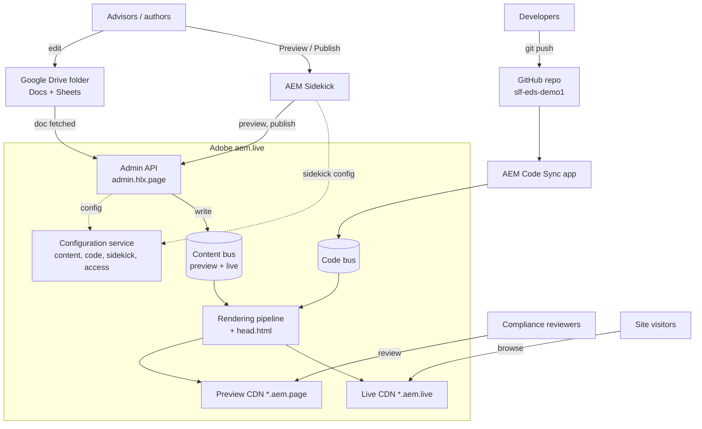
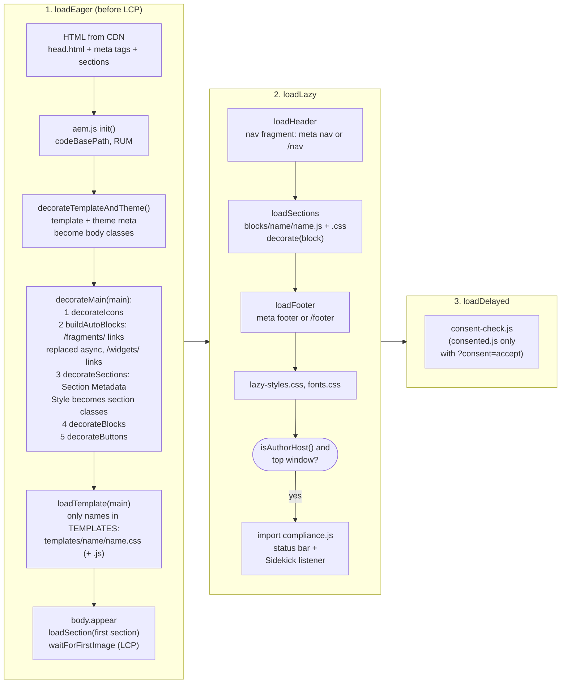
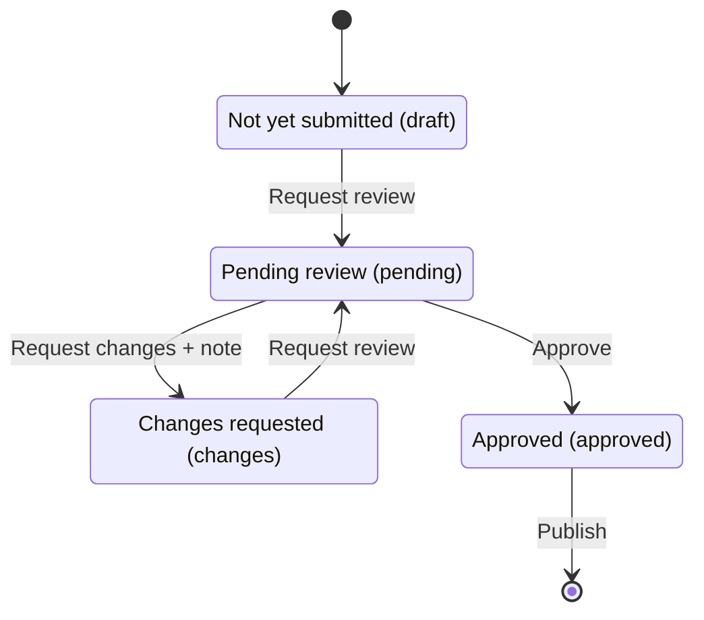
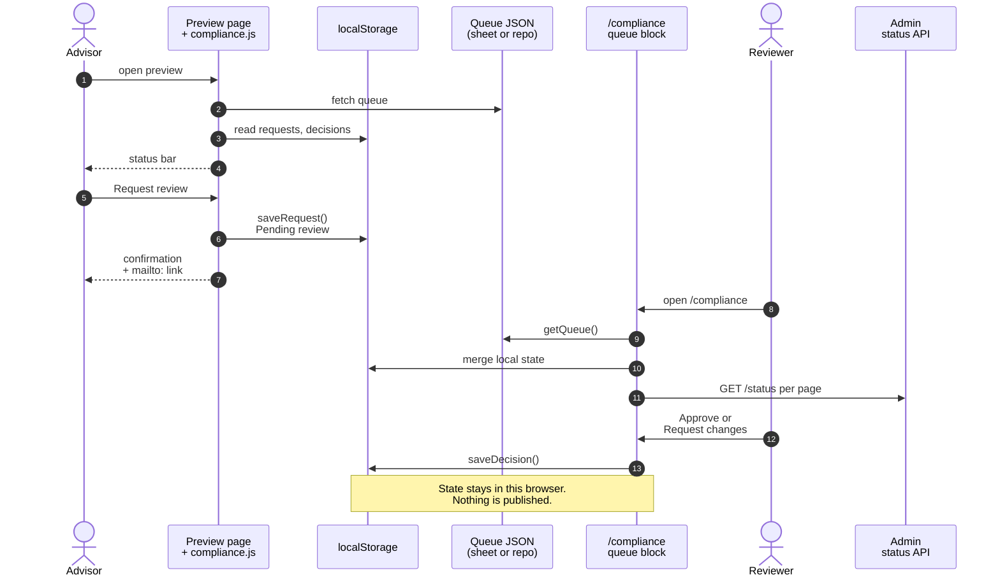
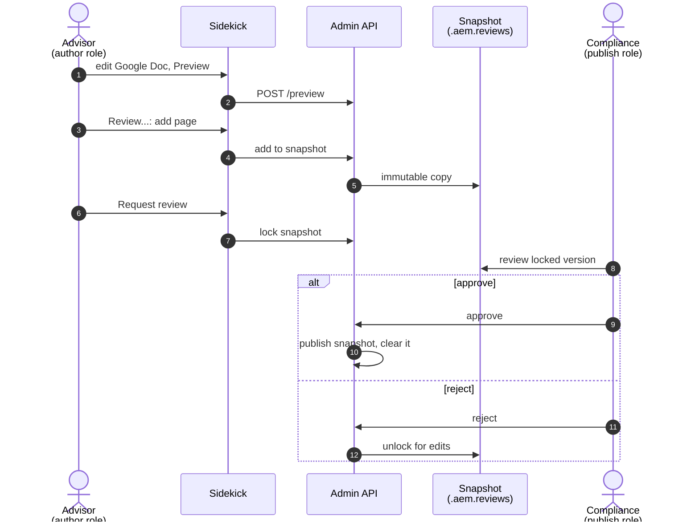
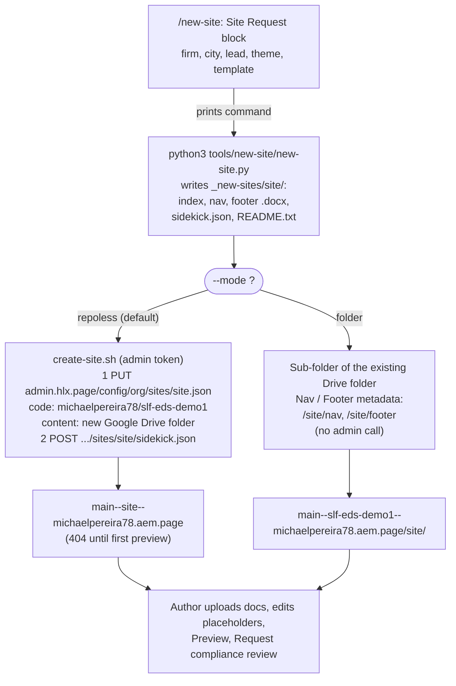
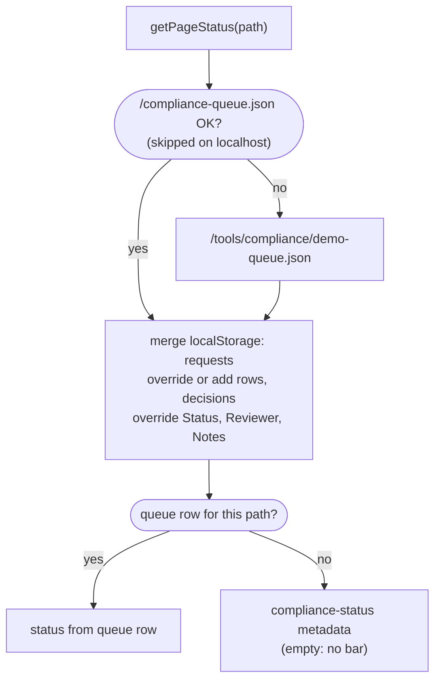

# Advisor Web Platform on AEM Edge Delivery Services: Technical Handoff

| | |
|---|---|
| **Author** | Michael Pereira, Director of Engineering |
| **Audience** | Software developers taking over the platform (new to this codebase) |
| **Date** | November 24, 2026 |
| **Repository** | <https://github.com/michaelpereira78/slf-eds-demo1>, branch `main`, baseline commit `16b26db` |
| **Preview** | <https://main--slf-eds-demo1--michaelpereira78.aem.page> |
| **Live** | <https://main--slf-eds-demo1--michaelpereira78.aem.live> |
| **Status** | Demo platform. All firms, people, phone numbers (555) and email addresses (`@example.com`) are fictional. Not Sun Life branded, not affiliated with Sun Life. |

> **How to read this document.** Sections 1 and 2 give the big picture. Sections 3 to 10 are the
> reference for each part of the system. Sections 11 and 12 cover day-to-day development and access.
> Section 13 lists known limitations, review findings and the hardening backlog. Every file path,
> metadata key, CSS variable and block name below is taken from the code at commit `16b26db`.
> If the code and this document disagree, the code wins. Please fix this document in the same PR.

## 1. Overview and goals

### 1.1 What this is

A business-user demo showing that financial-advisor websites can be created, edited, re-styled and
approved on [Adobe Edge Delivery Services](https://www.aem.live/) (EDS, aem.live) without a developer
in the loop. Content is authored in Google Docs and Google Sheets in one Google Drive folder. The code
is one GitHub repository built on [adobe/aem-boilerplate](https://github.com/adobe/aem-boilerplate)
(Apache-2.0), with no build step: the files in the repo are the files served.

The demo hosts three fictional firms on one site:

| Firm | Path | Template | Theme | Demo compliance state |
|---|---|---|---|---|
| Maple Ridge Wealth Partners (Calgary) | `/`, `/advisors/jordan-lee` | `advisor-team` | Forest | Approved |
| Harbourview Financial Group (Halifax) | `/harbourview/` | `advisor-team` | Harbour | Pending review |
| Northstar Planning (Victoria, solo) | `/northstar/` | `solo-advisor` | Slate | Changes requested |
| Maple Ridge campaign | `/campaigns/retirement-checkup` | `campaign` | Forest | Pending review |

A presenter hub lives at `/demo`, and capability pages at `/layouts`, `/templates`,
`/approved-content`, `/new-site` and `/compliance`. The presenter script is `DEMO-SCRIPT.md`.

### 1.2 The seven capabilities

| # | Capability | How it is implemented | Main code |
|---|---|---|---|
| 1 | **Generate new sites** | Intake form (`Site Request` block) produces a generator command. `tools/new-site/new-site.py` writes starter documents plus `create-site.sh`, which makes the single repoless Admin API call `PUT /config/{org}/sites/{site}.json`. `--mode folder` creates a sub-site inside this site instead (how `/harbourview/` and `/northstar/` are set up). | `blocks/site-request/`, `tools/new-site/new-site.py` |
| 2 | **Content changes** | Edit the Google Doc, then Sidekick **Preview**, then **Publish**. Standard aem.live. | none (platform) |
| 3 | **Minor layout changes** | Section Metadata `Style` values (`Light`, `Dark`, `Accent`, `Centered`, `Narrow`, `Sidebar`, combinable) and block variants (`Hero (Light)`, `Contact (Card)`, `Callout (CTA)` and so on). | `styles/styles.css`, block CSS |
| 4 | **Templates (approved set, extensible)** | `Template` metadata loads `templates/<name>/<name>.css` (+ optional `.js`) only if `<name>` is in the `TEMPLATES` allow-list in `scripts/scripts.js`. Starter documents are offered in the Sidekick Library. | `scripts/scripts.js`, `templates/` |
| 5 | **Per-site branding** | `Theme` metadata becomes a `<body>` class; `body.harbour` / `body.slate` override design tokens (CSS custom properties). Blocks use tokens only. | `styles/styles.css` |
| 6 | **Authoring with approved content** | Compliance-owned fragments under `/fragments/`. A link to a fragment on its own line is replaced by the fragment's content. A custom Sidekick Library plugin lists them with **Copy link**. | `scripts/scripts.js` (`buildAutoBlocks`), `blocks/fragment/`, `tools/sidekick/` |
| 7 | **Compliance review and approval** | Status bar on preview hosts, **Request review** dialog, `/compliance` queue. Demo state is kept in `localStorage`; production path is native Snapshots and Reviews with Publish restricted by role. | `scripts/compliance.js`, `scripts/compliance-data.js`, `blocks/compliance-queue/` |

### 1.3 Design principles (please keep them)

1. **Platform features first.** Everything a business user does is a standard aem.live feature
   (documents, metadata, Sidekick, fragments, snapshots). Custom code is limited to presentation and
   a demo-grade compliance UI.
2. **No build step.** Plain ES modules and CSS. `package.json` has devDependencies only (linters).
3. **Tokens, not colours.** Blocks and templates reference CSS custom properties so every theme works
   with every block and template.
4. **Allow-lists over free text.** Templates must be registered in code; themes must exist in CSS.
   Unknown values fall back to defaults rather than breaking the page.
5. **Author-only UI never reaches visitors.** Compliance bar and approval badges render only on
   `localhost`, `*.aem.page` and `*.aem.reviews` (`scripts/author.js`, `isAuthorHost()`).
6. **No Microsoft Power Automate and no @aem VS Code Copilot extension.** Neither is used by this
   organization; do not introduce them. Workflow is built on Snapshots and Reviews and access roles.

## 2. Architecture

### 2.1 System context



Key facts:

- **Content source** is the Google Drive folder
  `https://drive.google.com/drive/u/0/folders/1lC_k-4iU8d2cmsKwagdWcDEDz5wQRQ1O` (type `google`),
  configured in the **aem.live configuration service**. There is **no `fstab.yaml`**; `AGENTS.md`
  records that `fstab.yaml`, `helix-query.yaml` and `paths.json` are retired for this project.
- **Code** is deployed by the **AEM Code Sync** GitHub App. Every push to any branch is synced;
  `main` is what `main--…` hosts serve. Merging to `main` ships code; content publishes separately.
- **Preview** (`*.aem.page`) reflects the latest **Preview** of each document. **Live**
  (`*.aem.live`) reflects the latest **Publish**. Both get `robots.txt` `Disallow: /`, and preview
  responses carry `x-robots-tag: noindex, nofollow`.
- **Sidekick configuration** is stored in the configuration service (posted via the Admin API, see
  section 10.2). The effective config can be read at
  <https://admin.hlx.page/sidekick/michaelpereira78/slf-eds-demo1/main/config.json>.

### 2.2 Page render pipeline (browser)

Each page is server-rendered by aem.live into a minimal HTML document whose `<head>` contains the
contents of `head.html` (CSP, `scripts/aem.js`, `scripts/scripts.js`, `styles/styles.css`) plus the
page's `<meta>` tags generated from its Metadata table. Everything else happens in the browser,
in three phases defined in `scripts/scripts.js`.



Details worth knowing:

- **Metadata to classes.** `decorateTemplateAndTheme()` in `scripts/aem.js` adds every
  comma-separated value of `template` and `theme` metadata as a class on `<body>` (via
  `toClassName`, so `Harbour` becomes `harbour`). The theme needs no JavaScript; CSS alone reacts.
- **Template loading.** `loadTemplate()` in `scripts/scripts.js` computes
  `toClassName(getMetadata('template'))`, looks it up in `TEMPLATES`, and if present loads
  `${window.hlx.codeBasePath}/templates/<name>/<name>.css` and, when `js: true`, imports
  `<name>.js` and calls its default export with `main`. Failures are logged, never thrown.
- **Blocks.** A block table named `Team Cards (X, Y)` in a document becomes
  `<div class="team-cards x y">`. `decorateBlocks()` marks it, and `loadSections()` loads
  `blocks/team-cards/team-cards.css` and `.js` and calls `decorate(block)`.
- **Fragments.** Two mechanisms:
  1. *Auto-block* (used by approved content): in `buildAutoBlocks()`, every `a[href*="/fragments/"]`
     not already inside a `.fragment` is fetched with `loadFragment(pathname)` and its *parent
     element* (the paragraph) is replaced by the fragment's sections. This runs asynchronously
     (not awaited) after a dynamic import of `blocks/fragment/fragment.js`.
  2. *Explicit block*: a `Fragment` block table containing a link or path.
  `loadFragment(path)` fetches `${path}.plain.html`, rewrites `./media_*` URLs to the fragment's
  base, runs `decorateMain()` and `loadSections()` on it. Only same-origin absolute paths
  (`/…`) are accepted, so a pasted `https://main--…aem.page/fragments/x` link resolves to
  `/fragments/x` **on the current host**.
- **Header and footer** are fragments too: `blocks/header/header.js` loads `getMetadata('nav')`
  or `/nav`; `blocks/footer/footer.js` loads `getMetadata('footer')` or `/footer`. That is how a
  folder sub-site gets its own navigation (`Nav: /harbourview/nav`).
- **Header structure.** The nav document has three sections, classed in order `nav-brand`,
  `nav-sections`, `nav-tools`. Nested lists in `nav-sections` become dropdowns. The footer
  document's sections are classed `footer-brand`, `footer-links`, `footer-legal`.

### 2.3 Compliance workflow: states



The four internal keys and their labels come from `STATUS` in `scripts/compliance-data.js`.
The **Request review** button is shown only for `draft` and `changes`. **Approve** and
**Request changes** appear in the queue only for `pending` items. Section 8 explains where the state
is stored and how it is resolved.

### 2.4 Compliance workflow: demo sequence (as built)



### 2.5 Compliance workflow: production target (Snapshots and Reviews)



Approving a review publishes the snapshot and needs the `publish` role. Editing snapshots needs the
`author` role (see section 12).

### 2.6 New site provisioning



## 3. Repository map

Everything committed is served by aem.live unless it is listed in `.hlxignore`.

| Path | Purpose |
|---|---|
| `head.html` | Injected into every page `<head>`: CSP meta (`move-to-http-header="true"`, nonce `aem`, `strict-dynamic`, `require-trusted-types-for 'script'`), viewport, `scripts/aem.js`, `scripts/scripts.js`, `styles/styles.css`. |
| `404.html` | Custom 404 page (boilerplate). |
| `favicon.ico`, `fonts/*.woff2`, `icons/search.svg` | Static assets. Roboto (regular, medium, bold) and Roboto Condensed bold. |
| `images/avatars/*.svg` | Placeholder avatars used by the local drafts (10 fictional people). In Drive, documents embed PNGs from `slf-eds-demo1-content/_avatars/`. |
| `scripts/aem.js` | Vendored aem.live runtime (block loading, sections, metadata, RUM). **Never edit** (`AGENTS.md`). |
| `scripts/scripts.js` | Page bootstrap: `TEMPLATES` allow-list and `loadTemplate()`, Trusted Types policy, auto-blocks (fragments, widgets), `decorateButtons()`, `loadEager` / `loadLazy` / `loadDelayed`, compliance loader. |
| `scripts/author.js` | `isAuthorHost()` and `takeApproval()` (approval badge for approved content). |
| `scripts/compliance.js` | Compliance status bar, **Request review** dialog, Sidekick `custom:request-compliance-review` listener. Loaded only on author hosts. |
| `scripts/compliance-data.js` | Queue data: `STATUS`, `statusKey()`, `normalizePath()`, `siteInfo()`, `getQueue()`, `getPageStatus()`, `saveRequest()`, `saveDecision()`, `resetDemo()`; `localStorage` key `advisor-demo-compliance`. |
| `scripts/consent-check.js`, `scripts/consented.js` | Placeholder consent manager; consent declined by default, `?consent=accept` loads the (empty) `consented.js`. |
| `styles/styles.css` | Design tokens (`:root`), **BRAND THEMES** (`body.harbour`, `body.slate`), derived tokens on `body`, buttons, section styles. |
| `styles/compliance.css` | Status bar and review dialog styles (loaded on demand). |
| `styles/fonts.css`, `styles/lazy-styles.css` | Web fonts (loaded lazily or eagerly on desktop); post-LCP styles (empty). |
| `blocks/<name>/<name>.{js,css}` | One folder per block (section 4.4). |
| `templates/advisor-team/advisor-team.css` | Accent rule under section H2s. |
| `templates/solo-advisor/solo-advisor.css` | Rounded portrait, left accent bar on H2s, 880 px reading width. |
| `templates/campaign/campaign.{css,js}` | Hides nav sections and hamburger, larger hero heading, sticky phone CTA (`.campaign-sticky-cta`) cloned from the hero's primary button. |
| `tools/sidekick/library.html` | Sidekick Library host page (loads `https://tools.aem.live/tools/sidekick/library/index.js`, base `/tools/sidekick/library.json`, plugins `blocks` and `approved-content`). |
| `tools/sidekick/plugins/approved-content/approved-content.js` | Custom Library plugin listing `helix-approved-content` rows with **Copy link** and **Preview**. |
| `tools/compliance/demo-queue.json` | Fallback compliance queue (5 rows), served from code. |
| `tools/content.py` | Single source of truth for all demo content (pages, metadata, sheets). Not served. |
| `tools/build-content.py` | Renders `tools/content.py` into `drafts/*.plain.html` and `.docx`/`.xlsx` for upload. Not served. |
| `tools/new-site/new-site.py` | New site generator. Not served. |
| `drafts/` | Local content for `aem up --html-folder drafts` (generated, do not hand-edit). Not served. |
| `docs/ADMIN-SETUP.md` | Manual one-time steps (Drive upload, preview/publish, Sidekick POST, optional roles, optional repoless). |
| `docs/ADD-A-TEMPLATE.md` | How to add a template or a brand theme. |
| `docs/sidekick.json` | The Sidekick configuration to POST (also the input for generated sites). |
| `docs/TECHNICAL-HANDOFF.md` | This document. |
| `README.md`, `DEMO-SCRIPT.md` | Overview and 12-minute presenter script. |
| `AGENTS.md`, `CLAUDE.md` | Rules for AI coding agents (`CLAUDE.md` contains only `see @AGENTS.md`). |
| `.github/workflows/main.yaml` | CI: on every push, `npm ci` then `npm run lint`. |
| `.github/pull_request_template.md` | PR template asking for issue and before/after test URLs. |
| `.hlxignore` | Not served: dotfiles, `*.md`, `package*.json`, `drafts/*`, `docs/*`, `tools/*.py`, `tools/__pycache__/*`, `tools/new-site/*`, `test/*`, and others. `tools/sidekick/` and `tools/compliance/` **are** served. |
| `.eslintrc.js`, `.stylelintrc.json`, `.editorconfig`, `.eslintignore` | Lint configuration (airbnb-base, stylelint-config-standard). |
| `package.json` | Scripts `lint`, `lint:js`, `lint:css`, `lint:fix`, `start`, `build:content`, `new-site`. No runtime dependencies. |

Upload-ready content lives **outside** the repo in `/workspace/slf-eds-demo1-content/` (zipped as
`slf-eds-demo1-content.zip` for Michael's upload): root documents `index`, `nav`, `footer`, `demo`,
`templates`, `layouts`, `approved-content`, `new-site`, `compliance` (`.docx`), spreadsheet
`compliance-queue.xlsx`, folders `advisors/`, `campaigns/`, `fragments/`, `harbourview/`,
`northstar/`, `tools/` (with `tools/sidekick/library.xlsx` and the template and block docs),
plus `_avatars/` and `_new-sites/` (do not upload) and `UPLOAD-ME.txt`.

## 4. Content model

### 4.1 Documents and paths

The Drive folder hierarchy is the URL hierarchy. `index` maps to the folder path (`/harbourview/index`
is served at `/harbourview/`). Document names become lowercase, hyphenated paths.

| Path | Kind | Notes |
|---|---|---|
| `/`, `/advisors/jordan-lee` | Maple Ridge home and profile | `advisor-team` / Forest; profile has no `Template` (default layout) |
| `/nav`, `/footer` | Default header and footer fragments | 3 sections each |
| `/harbourview/`, `/harbourview/nav`, `/harbourview/footer` | Folder sub-site | `Nav`/`Footer` metadata point to its own fragments |
| `/northstar/`, `/northstar/nav`, `/northstar/footer` | Folder sub-site | `solo-advisor` / Slate |
| `/campaigns/retirement-checkup` | Campaign landing page | `campaign` / Forest |
| `/fragments/disclosure` | Regulatory disclosure (`Disclosure` block) | Approval `AC-2026-001` |
| `/fragments/products/retirement-income`, `/tfsa-rrsp`, `/insurance-protection` | Approved product copy (`Callout`) | `AC-2026-031`, `AC-2026-018`, `AC-2026-022` |
| `/fragments/cta/book-a-review` | Approved CTA (`Callout (CTA)`) | `AC-2026-040` |
| `/demo`, `/layouts`, `/templates`, `/approved-content`, `/new-site`, `/compliance` | Capability pages | `Robots: noindex` |
| `/tools/sidekick/templates/{advisor-team,solo-advisor,campaign}` | Template starter docs | `Library Metadata` `type` = `template` |
| `/tools/sidekick/blocks/{hero,callout,contact}` | Block examples for the Library | `Robots: noindex` |
| `/tools/sidekick/library` | Spreadsheet driving the Library | section 7 |
| `/compliance-queue` | Spreadsheet: compliance queue | section 8 |

### 4.2 Page metadata (Metadata table)

Each document ends with a `Metadata` block table. aem.live turns each row into a `<meta>` tag
(key lowercased and hyphenated: `Compliance Status` becomes `<meta name="compliance-status">`).

| Key | Allowed values | Read by | Effect |
|---|---|---|---|
| `Title` | text | aem.live | `<title>` and `og:title`. Convention: page title, a vertical bar, then the site name. `compliance.js` uses the text after the bar as the site name in review requests, unless it is `Advisor Demo` (then it uses the text before the bar). |
| `Description` | text | aem.live | `meta description`, `og:description`. |
| `Template` | `advisor-team`, `solo-advisor`, `campaign` | `aem.js`, `scripts.js` | Body class + template CSS/JS. Values not in `TEMPLATES` only add a body class (no template loaded). Case-insensitive (`toClassName`). |
| `Theme` | `Forest`, `Harbour`, `Slate` | `aem.js`, CSS | Body class. `Forest` is the `:root` default, so there is no `body.forest` rule; any unknown value renders as Forest. |
| `Nav` | path, e.g. `/harbourview/nav` | `header.js` | Header fragment (default `/nav`). |
| `Footer` | path, e.g. `/harbourview/footer` | `footer.js` | Footer fragment (default `/footer`). |
| `Compliance Status` | `Approved`, `Pending review`, `Changes requested`, `Draft` (any text; see mapping) | `compliance-data.js` | Fallback status when the page has no queue row. Empty means the page is outside the review process: no status bar. |
| `Approved By`, `Approval Date` | text, `YYYY-MM-DD` | `compliance-data.js` | Shown in the bar for approved pages. |
| `Reviewer`, `Review Date` | text, `YYYY-MM-DD` | `compliance-data.js` | Shown in the bar for other states. |
| `Compliance ID` | e.g. `CR-2026-0412` | nobody | Rendered as `<meta name="compliance-id">` but not used by code. |
| `Robots` | `noindex` | aem.live | `meta robots`. Used on capability and tools pages. |

`statusKey(value)` mapping (case-insensitive): starts with `approved` gives `approved`; contains
`pending` or `review` gives `pending`; contains `change` or `reject` gives `changes`; anything else
(including `Draft`) gives `draft`. The order matters: a value such as "Rejected after review" maps to
`pending` because the `review` test runs first.

### 4.3 Section Metadata styles

A `Section Metadata` table with a `Style` row adds classes to its section. Values are
comma-separated and combinable (`Dark, Centered`). Rules are in `styles/styles.css`.

| Style | Class | Effect |
|---|---|---|
| `Light` | `.light` (alias `.highlight`) | `--light-color` background, top border, 40 px padding, no outer margin |
| `Dark` | `.dark` | `--navy-color` background, 48 px padding, white text and headings, accent-coloured links, white-outline secondary buttons |
| `Accent` | `.accent` | `--accent-tint` background, 48 px padding |
| `Centered` | `.centered` | Centred text; paragraphs and H2s max 62ch |
| `Narrow` | `.narrow` | Content column max 760 px |
| `Sidebar` | `.sidebar` | From 900 px: content left, the section's **last block** (typically `Contact (Card)`) in a sticky right column (grid `2fr` / `minmax(280px, 1fr)`) |

Adjacent shaded sections (`light`, `dark`, `accent`) touch without a border.

### 4.4 Blocks

Block names in documents are case-insensitive; variants go in brackets: `Hero (Light, Centered)`.

| Block (folder) | Authored structure | Variants | Notes |
|---|---|---|---|
| `hero` | One cell: optional eyebrow paragraph, H1, intro, button paragraphs. Profile layout: an image-only cell plus a text cell. | `Light`, `Centered`, `Profile` | A paragraph before the H1 becomes `.hero-eyebrow`; buttons are grouped in `.hero-actions`; an image-only cell becomes `.hero-media` (eager, `fetchPriority=high`) and adds `.hero-has-media`. The circular portrait is styled from `.hero-media`, not from a `.profile` class. |
| `team-cards` | One row per person: image, `Name, Credentials` (link it to make a profile link), title, bio, email, phone | none | Cells are detected defensively: first picture, first text cell is the name, email/phone by regex, remaining text cells are title then bio. Renders `ul > li.team-cards-card` with `tel:`/`mailto:` links and **View profile**. |
| `contact` | Rows `label` and `value` | `Card` | Icons by label keyword (office/address, phone/line, email, hours/open). Phone/email values become links. A link-only value becomes a button (external links open in a new tab). `Card` adds a "Get in touch" heading. |
| `disclosure` | One cell with a heading and paragraphs; optional last row `Approved` and ID | none | Heading normalised to H2; `role="note"`. |
| `callout` | One cell; optional last row `Approved` and ID | `CTA` | `Approved` row becomes a preview-only badge and adds `.callout-approved`. |
| `cards` | Rows of image and body cells | `Capabilities`, `Sites`, `Templates` | Boilerplate cards; the three variants share a card-grid style used on `/demo` and `/templates`. |
| `columns` | One row, N cells | none | Boilerplate; adds `columns-N-cols`. |
| `fragment` | Link or path to a fragment | none | Also exports `loadFragment()` used by auto-blocks, header and footer. |
| `site-request` | Empty block | none | Intake form; theme radios re-theme the page live. No data leaves the page. |
| `compliance-queue` | Empty block | none | Review queue UI (section 8). |
| `library-metadata` | Rows `name`, `description`, `type` | none | Read by the Sidekick Library; removed from the rendered page. |
| `widget` | Auto-built from links containing `/widgets/` | none | Boilerplate. There is **no `/widgets/` folder** in this repo, so it is unused. |
| `header`, `footer` | Loaded automatically | none | Section 2.2. |

**Buttons.** A link alone in a paragraph becomes a button only if formatted: **bold** gives
`.button.primary`, *italic* gives `.button.secondary`, ***bold italic*** gives `.button.accent`.
Plain links and links whose text is the URL stay links.

**Approval badge.** `takeApproval(block)` in `scripts/author.js` removes a two-cell row whose first
cell is `Approved`, stores the text in `data-approval`, and on author hosts appends
`<p class="approval-badge">Approved content: …</p>`.

### 4.5 Spreadsheets and JSON endpoints

| Sheet (Drive) | Endpoint | Sheets and columns | Consumer | Current state |
|---|---|---|---|---|
| `tools/sidekick/library` | `/tools/sidekick/library.json` | `helix-blocks`: `name`, `path`. `helix-approved-content`: `name`, `path`, `approval`, `description` | Sidekick Library | **404 on preview** (not previewed yet) |
| `compliance-queue` | `/compliance-queue.json` | `Sheet1`: `Page`, `Title`, `Site`, `Submitted By`, `Submitted`, `Status`, `Reviewer`, `Decision Date`, `Notes`, `Snapshot` | `compliance-data.js` | **404 on preview** (known gap; queue falls back to demo data) |
| (code) `tools/compliance/demo-queue.json` | `/tools/compliance/demo-queue.json` | same columns, `{ total, offset, limit, data }` | fallback | 200 |

`rowsFromJson()` accepts both single-sheet (`data` at the root) and multi-sheet (`:names`) JSON.

## 5. Templates

### 5.1 Where they live and how they load

- Code: `templates/<name>/<name>.css` and optional `templates/<name>/<name>.js`
  (default export `decorate(main)`).
- Allow-list: `TEMPLATES` in `scripts/scripts.js`:

```js
const TEMPLATES = {
  'advisor-team': { js: false },
  'solo-advisor': { js: false },
  campaign: { js: true },
};
```

- Selection: `Template` metadata. `loadTemplate()` runs in `loadEager()` after `decorateMain()` and
  before the first section is shown, so template CSS applies before first paint of the content.
- Starter documents: `/tools/sidekick/templates/<name>` in Drive (generated from `tools/content.py`),
  listed in the `helix-blocks` sheet so they appear in the Sidekick Library.
- Scope: template CSS must be scoped to `body.<name>`.

| Template | Purpose | Code behaviour |
|---|---|---|
| `advisor-team` | Team home page: hero, team cards, contact, disclosure | 56 x 4 px accent rule under section H2s |
| `solo-advisor` | One-advisor home: portrait hero, story, services, sticky contact card | Rounded-corner portrait (320 px from 900 px), left accent border on H2s, 880 px max width for non-sidebar sections |
| `campaign` | Landing page: centred hero, three benefits, approved CTA | Hides `.nav-sections` and hamburger; hero H1 `max-width: 12em`; `campaign.js` clones `.hero a.button.primary` into `.campaign-sticky-cta`, shown under 900 px once the hero leaves the viewport (`IntersectionObserver`), offset by `--author-bar-height` |

### 5.2 How to add a template (step by step)

Based on `docs/ADD-A-TEMPLATE.md` (about 30 minutes):

1. Create a branch, e.g. `template-branch-office`.
2. Create `templates/branch-office/branch-office.css`. Scope every rule to `body.branch-office`.
   Use tokens only (`var(--navy-color)`, `var(--accent-color)`, `var(--radius)`, and so on).
3. If behaviour is needed, add `templates/branch-office/branch-office.js` exporting
   `export default function decorate(main) { … }`. Keep it defensive (authors omit content).
4. Register it in `TEMPLATES` in `scripts/scripts.js`: `'branch-office': { js: false }`
   (or `true`). Unregistered names never load, which is how the approved set is enforced.
5. Add a starter page in `tools/content.py` under `PAGES['tools/sidekick/templates/branch-office']`
   with a `Library Metadata` section (`name`, `description`, `type` = `template`) and Metadata
   `Template`, `Theme`, `Compliance Status` = `Draft`, `Robots` = `noindex`.
6. Add `{'name': 'Template: Branch office', 'path': '/tools/sidekick/templates/branch-office'}` to
   `SHEETS['tools/sidekick/library']['helix-blocks']`.
7. Optionally add it to `TEMPLATES` in `blocks/site-request/site-request.js` and `tools/new-site/new-site.py`
   (and a `pages()` branch for its starter layout) so new sites can choose it, and add a card on
   the `templates` page.
8. Run `python3 tools/build-content.py ../slf-eds-demo1-content` and `npm start`; test a draft page
   with `Template: branch-office` at `http://localhost:3000/...`.
9. `npm run lint`, push the branch, open a PR with
   `https://template-branch-office--slf-eds-demo1--michaelpereira78.aem.page/<path>` test links.
10. After merge: upload the starter doc to `tools/sidekick/templates/` in Drive, update the
    `tools/sidekick/library` sheet, preview and publish both. Brand and Compliance review an example
    page before the template is announced.

## 6. Theming

### 6.1 Tokens

Defined on `:root` in `styles/styles.css` (Forest defaults):

| Token | Forest (default) | Harbour | Slate |
|---|---|---|---|
| `--background-color` | `#fff` | (inherits) | (inherits) |
| `--light-color` | `#f3f6f4` | `#f2f4fb` | `#f6f4ef` |
| `--dark-color` | `#4b5a54` | `#4a5170` | `#55524b` |
| `--text-color` | `#1c2622` | `#1a1f36` | `#1f2124` |
| `--link-color` | `#2a6b55` | `#1d6b74` | `#8a5300` |
| `--link-hover-color` | `#1e4d3b` | `#1f2a5c` | `#2b2f36` |
| `--accent-color` | `#f9a66c` | `#5fd3c1` | `#f2b134` |
| `--accent-hover-color` | `#f48c47` | `#3fbfab` | `#e09b12` |
| `--navy-color` (primary brand) | `#1e4d3b` | `#1f2a5c` | `#2b2f36` |
| `--border-color` | `#d9e2dc` | `#d8dcef` | `#e2ded3` |
| `--focus-color` | `#2a6b55` | `#1d6b74` | `#8a5300` |
| `--radius` | `12px` | `18px` | `4px` |
| `--heading-font-family` | Roboto | (inherits) | `georgia, 'Times New Roman', serif` |

Also on `:root`: `--body-font-family`, `--body-font-size-{m,s,xs}`, `--heading-font-size-{xxl…xs}`
(smaller from 900 px), `--nav-height: 64px`. Derived tokens are defined on `body` (so themes cascade
into them): `--card-shadow`, `--card-shadow-hover`, `--accent-tint` (all via `color-mix()` from
`--navy-color` / `--accent-color`). `--author-bar-height` is set at runtime by the compliance bar.

Note: `--navy-color` is the historical boilerplate name for the primary brand colour; it is green in
Forest and charcoal in Slate.

### 6.2 Theme names and how they apply

`Theme` metadata (`Forest`, `Harbour`, `Slate`) becomes a body class. Theme scope is per page; a site
gets one theme by setting it on every page (the generator does this). Bulk metadata (a `metadata`
sheet) could set it per folder, but this project currently has no `/metadata.json` (404).

### 6.3 How to add a brand

1. Add `body.<theme> { … }` to the BRAND THEMES section of `styles/styles.css`, overriding the colour
   tokens (and optionally `--heading-font-family`, `--radius`).
2. Check contrast: text on `--background-color` and `--light-color`, white on `--navy-color`, and
   `--navy-color` on `--accent-color` buttons, at least 4.5:1.
3. Add the theme to `THEMES` in `blocks/site-request/site-request.js` (`[value, label, description,
   [swatches]]`) and in `tools/new-site/new-site.py` (`THEMES = {'forest': 'Forest', …}`).
4. Test with `Theme: <Name>` on a draft, `npm run lint`, PR, merge. No content change is needed until
   an author picks the theme.

## 7. Approved content library and Sidekick Library

### 7.1 Approved content (fragments)

- Compliance-owned documents under `/fragments/` (product descriptions, CTA, disclosure). Each ends
  with an `Approved | <ID>` row (badge on preview only).
- Authors embed them by placing a **link on its own line** (e.g. to `/fragments/products/tfsa-rrsp`).
  `buildAutoBlocks()` replaces the paragraph with the fragment. Authors cannot alter the wording on
  their page because it is not in their document.
- When Compliance updates and publishes a fragment, every page shows the new text at once
  (fragments are fetched client-side at view time, so pages need no re-publish).
- Enforcement that only Compliance can edit `/fragments/` comes from **Google Drive sharing** on that
  folder, which is not configured in the demo.

### 7.2 Sidekick Library

- Sidekick plugin `library` (environment `edit`, i.e. when a Google Doc is open) opens
  `/tools/sidekick/library.html`.
- `library.html` loads the official library (`https://tools.aem.live/tools/sidekick/library/index.js`)
  with `base: '/tools/sidekick/library.json'` and two plugins:
  - `blocks` (built in, `encodeImages: false`), reading the `helix-blocks` sheet: the three block
    example docs and the three template starter docs (template docs carry `Library Metadata`
    `type` = `template`).
  - `approved-content` (custom, `tools/sidekick/plugins/approved-content/approved-content.js`),
    reading `helix-approved-content`. Searchable; **Copy link** writes both `text/html`
    (`<a href>`) and `text/plain` to the clipboard; **Preview** opens the fragment.
- **Current gap:** `/tools/sidekick/library.json` returns 404 on preview, so the Library is empty
  until the `tools/sidekick/library` sheet is previewed and published.

## 8. Compliance workflow

### 8.1 Status values

| Key | Label | Bar colour class | Actions |
|---|---|---|---|
| `draft` | Not yet submitted | `status-draft` | Request review |
| `pending` | Pending review | `status-pending` | Queue: Approve, Request changes |
| `changes` | Changes requested | `status-changes` | Request review |
| `approved` | Approved | `status-approved` | none ("Ready to publish") |

### 8.2 Where state lives and how it is resolved

`getPageStatus(path)` in `scripts/compliance-data.js`:



- **Queue sheet** (`compliance-queue`): the Compliance-owned record. Today it 404s (not previewed),
  so every author host uses the repo fallback `tools/compliance/demo-queue.json`. The queue footer
  says "Queue source: built-in demo data" in that case and "the compliance-queue sheet" when the
  sheet is live.
- **localStorage** (key `advisor-demo-compliance`, shape `{ requests: [], decisions: {} }`):
  `saveRequest()` replaces any request for the same path and clears its decision;
  `saveDecision()` stores `{ Status, Reviewer, Notes, 'Decision Date' }` per normalised path;
  **Reset demo** calls `resetDemo()`. Local items show "demo action in this browser".
- **Page metadata**: used only when the page has no queue row.
- The status bar is skipped on paths starting with `/compliance`, `/tools/`, `/fragments/`, `/nav`,
  `/footer`, and on pages with no status at all.
- The queue shows real **Previewed / Published** times by calling
  `https://admin.hlx.page/status/{org}/{site}/{ref}{path}` from the browser (`siteInfo()` parses the
  host; falls back to `main` / `slf-eds-demo1` / `michaelpereira78`).
- The review dialog fields: name, review team (`Advisor marketing compliance`, `Insurance compliance`,
  `Investments compliance`), notes, and three required checklist items. It sends no email; it offers
  a pre-filled `mailto:compliance@example.com` link.
- Sidekick integration: the custom plugin `request-compliance-review` fires the event
  `custom:request-compliance-review` on `aem-sidekick`; `compliance.js` listens (also after
  `sidekick-ready`) and opens the dialog.

### 8.3 Demo behaviour vs. production path

| Concern | Demo (as built) | Production target |
|---|---|---|
| Request review | Dialog writes `localStorage` | Sidekick **Review...**: add pages to a snapshot, **Request review** locks it |
| What is reviewed | Current preview | The immutable snapshot on `{snapshot}--main--{site}--{org}.aem.reviews` |
| Approve | Writes `localStorage`, nothing published | **Approve** publishes the snapshot (needs `publish` role) |
| Reject | Writes `localStorage` | **Reject** unlocks the snapshot |
| Who can publish | Anyone (no access config; default role `basic_publish`) | Only the Compliance group has `publish`; authors get `author` |
| Queue | Sheet, else repo JSON, merged with browser state | Snapshot admin (`https://tools.aem.live/tools/snapshot-admin/index.html`) and/or the queue sheet maintained by Compliance |
| Notifications | `mailto:` link | Outside this repo (no Power Automate) |

Production access config (from `docs/ADMIN-SETUP.md` step 4, corrected for snapshot permissions,
see 13.3):

```json
POST https://admin.hlx.page/config/<org>/sites/<site>/access/admin.json
{ "role": {
    "author":  ["*@yourcompany.com"],
    "publish": ["compliance-publishers@yourcompany.com"],
    "admin":   ["platform-admins@yourcompany.com"] } }
```

Adding any role mapping turns on sign-in for every Sidekick user (`requireAuth` `auto`). Do not
apply this to the demo site.

## 9. New site generation

### 9.1 Usage

```sh
pip install python-docx openpyxl
python3 tools/new-site/new-site.py --firm "Prairie Sky Financial" --city "Regina, SK" \
  --lead "Sam Rivera, CFP" --theme harbour --template advisor-team [--mode repoless|folder] \
  [--site prairie-sky] [--out DIR]
# or: npm run new-site -- --firm ... (same arguments)
```

| Argument | Values | Default |
|---|---|---|
| `--firm`, `--city`, `--lead` | text (required) | |
| `--theme` | `forest`, `harbour`, `slate` | `forest` |
| `--template` | `advisor-team`, `solo-advisor`, `campaign` | `advisor-team` |
| `--mode` | `repoless`, `folder` | `repoless` |
| `--site` | site name | slug of `--firm`, max 40 chars |
| `--out` | output directory | `../slf-eds-demo1-content/_new-sites` |

### 9.2 Outputs (`<out>/<site>/`)

- `index.docx`, `nav.docx`, `footer.docx`: starter documents rendered with `build-content.py`'s
  `page_docx()`. Metadata: `Title`, `Description`, `Template`, `Theme`, `Compliance Status: Draft`,
  plus `Nav`/`Footer` in folder mode. Layout depends on the template (hero, team cards and contact for
  `advisor-team`; hero, story and `Contact (Card)` in a `Sidebar` section for `solo-advisor`;
  centred hero and `Columns` for `campaign`). Every page links `/fragments/disclosure`.
- `sidekick.json`: `docs/sidekick.json` with `project` set to the firm name.
- `create-site.sh` (repoless mode only) and `README.txt` (next steps).

An example run is in `slf-eds-demo1-content/_new-sites/prairie-sky-financial/`.

### 9.3 The Admin API calls (`create-site.sh`)

```sh
export AEM_ADMIN_TOKEN=<token>  DRIVE_FOLDER=https://drive.google.com/drive/folders/<id>
curl -fsS -X PUT "https://admin.hlx.page/config/$ORG/sites/$SITE.json" \
  -H "x-auth-token: $TOKEN" -H 'content-type: application/json' \
  --data '{"code":{"owner":"michaelpereira78","repo":"slf-eds-demo1"},
           "content":{"source":{"type":"google","url":"<DRIVE_FOLDER>"}}}'
curl -fsS -X POST "https://admin.hlx.page/config/$ORG/sites/$SITE/sidekick.json" \
  -H "x-auth-token: $TOKEN" -H 'content-type: application/json' --data @sidekick.json
# (commented out) POST .../sites/$SITE/access/admin.json with roles
```

- **Token:** an Admin API token for the `michaelpereira78` org with config write permission
  (`config_admin` or `admin` role). `create-site.sh` reads it from `AEM_ADMIN_TOKEN`. Alternatively,
  use **Site Admin** at <https://tools.aem.live> to add the site interactively. Never commit tokens.
- **Drive:** share the new folder with `helix@adobe.com` as Editor (per the generated `README.txt`).

### 9.4 Repoless rules

- One canonical site (`slf-eds-demo1`) is connected to the GitHub repo through Code Sync; repoless
  sites reference the same `code.owner` / `code.repo` and get code updates on every push to `main`.
- Each repoless site has its own content source, config, Sidekick config and access config.
  Configuration can also be shared via a **profile**.
- A new site is at `https://main--<site>--michaelpereira78.aem.page/` and shows 404 until content
  is previewed.
- Content is **not** shared: fragments, the Library sheet, `/compliance`, `/compliance-queue` and the
  nav/footer documents must exist in each site's own folder (see 13.3).
- Local development against a repoless site: `aem up --url https://main--<site>--michaelpereira78.aem.page`.

## 10. Configuration

### 10.1 Site configuration (configuration service)

- Org `michaelpereira78`, site `slf-eds-demo1`. No `fstab.yaml`.
- Effective values visible without a token (from the Sidekick config endpoint): `contentSourceType`
  `google`, `contentSourceUrl` (the Drive folder above), `previewHost`
  `main--slf-eds-demo1--michaelpereira78.aem.page`, `liveHost`
  `main--slf-eds-demo1--michaelpereira78.aem.live`.
- Full site config (needs a token): `GET https://admin.hlx.page/config/michaelpereira78/sites/slf-eds-demo1.json`
  (use tools.aem.live **Admin Edit**).
- No access config is set (the Admin status API reports `read`/`write` permissions to anonymous
  callers), no bulk metadata, redirects or index (`/metadata.json`, `/redirects.json`,
  `/query-index.json` are 404), no custom headers config is known, and no custom robots.

### 10.2 Sidekick configuration

Posted with tools.aem.live **Admin Edit** to
`https://admin.hlx.page/config/michaelpereira78/sites/slf-eds-demo1/sidekick.json`; source of truth in
the repo is `docs/sidekick.json`. The effective config currently matches it exactly (the old
`editUrlPattern` pointing at da.live is gone).

```json
{
  "project": "Advisor Demo",
  "plugins": [
    { "id": "library", "title": "Library", "environments": ["edit"],
      "url": "/tools/sidekick/library.html" },
    { "id": "request-compliance-review", "title": "Request compliance review",
      "environments": ["dev", "preview"], "event": "request-compliance-review" },
    { "id": "review", "title": "Review...", "environments": ["dev", "preview", "review"],
      "url": "https://tools.aem.live/tools/snapshot-admin/popover.html",
      "isPopover": true, "popoverRect": "width:400px; height:400px",
      "passConfig": true, "passReferrer": true },
    { "id": "compliance-queue", "title": "Compliance queue",
      "environments": ["preview", "review"], "url": "/compliance", "pinned": false }
  ]
}
```

| Plugin | Shown in | Behaviour |
|---|---|---|
| `project` | | Name shown in Sidekick |
| `library` | `edit` (Google Doc open) | Opens the Sidekick Library (section 7.2) |
| `request-compliance-review` | `dev`, `preview` | Fires `custom:request-compliance-review`; `compliance.js` opens the dialog |
| `review` | `dev`, `preview`, `review` | Official Snapshots and Reviews popover; `passConfig`/`passReferrer` give it org, site, ref and the page |
| `compliance-queue` | `preview`, `review` | Opens `/compliance`; `pinned: false` puts it in the overflow menu |

If a POST to `sidekick.json` is rejected, GET the site-level
`https://admin.hlx.page/config/michaelpereira78/sites/slf-eds-demo1.json`, edit only its `sidekick`
object and POST the whole document back (`docs/ADMIN-SETUP.md`).

### 10.3 Headers, CSP and robots

- **CSP** comes from `head.html` (`move-to-http-header="true"`); aem.live moves it into the HTTP
  header and replaces nonce `aem` with a per-response nonce:
  `script-src 'nonce-…' 'strict-dynamic' 'unsafe-inline' http: https:; base-uri 'self'; object-src 'none'; frame-src 'self' https:; require-trusted-types-for 'script';`
- **Trusted Types**: `scripts/scripts.js` registers `tt-inner` and a `default` policy that strips
  `srcdoc` from iframes and `<script>` from `createContextualFragment` / `document.write` input.
- **Robots**: platform default `Disallow: /` on `*.aem.page` and `*.aem.live`; `Robots: noindex`
  metadata on demo and tools pages. A production domain needs a robots config
  (<https://tools.aem.live/tools/robots-edit/index.html>) and CDN setup.
- Caching: preview responses carry `cache-control: max-age=60, must-revalidate`.

## 11. Local development, workflow and deployment

### 11.1 Setup

```sh
git clone https://github.com/michaelpereira78/slf-eds-demo1.git && cd slf-eds-demo1
npm install                     # linters only
npm start                       # aem up --html-folder drafts --html-mount / --no-open
# open http://localhost:3000/demo
```

`npm start` runs `npx -y @adobe/aem-cli up --html-folder drafts --html-mount / --no-open`, which
serves local code and the `drafts/*.plain.html` files as content. The drafts are already in
"pipeline" shape: Section Metadata styles are pre-applied as section classes and the Metadata block
sits in the last section (`tools/build-content.py`, `page_html()`). Locally, the compliance queue
skips the sheet and uses `tools/compliance/demo-queue.json`.

To work against real Drive content instead: `npx -y @adobe/aem-cli up` (proxies the preview host).
Always inspect the real markup first: `curl localhost:3000/<path>.plain.html` (`AGENTS.md`).

### 11.2 Content regeneration

```sh
pip install python-docx openpyxl
python3 tools/build-content.py ../slf-eds-demo1-content   # drafts/*.plain.html + .docx/.xlsx
```

`tools/content.py` is the single source of truth for demo content. Change it, regenerate, commit the
`drafts/` changes, and re-upload changed documents to Drive (then preview/publish). Word avatars are
read from `<out>/_avatars/<slug>.png`.

### 11.3 Quality gates

- `npm run lint` (ESLint airbnb-base + Stylelint standard). CI runs it on every push
  (`.github/workflows/main.yaml`). It passes at `16b26db`.
- **Tests:** there are no automated tests in the repo (`.hlxignore` references `test/*` and
  `karma.config.js`, but neither exists).
- **Lighthouse:** run mobile Lighthouse (Chrome DevTools, or `npx lighthouse <url> --form-factor=mobile`)
  on the branch preview URL. README records Performance 97-100 and Accessibility 100 locally on
  Nov 24, 2026; SEO is low on `*.aem.page` by design (robots). Keep performance at 100 on preview:
  aem.live projects are expected to stay green.

### 11.4 Branching, PRs and deployment

1. Branch from `main` (short, lowercase names; the branch becomes part of a hostname).
2. Push. Code Sync deploys the branch to `https://<branch>--slf-eds-demo1--michaelpereira78.aem.page/`
   (content is shared with `main`).
3. Open a PR. `AGENTS.md` requires a `{branch}--slf-eds-demo1--michaelpereira78.aem.page/{path}` test
   link; the PR template asks for issue and before/after URLs. CI lint must pass.
4. Merge to `main` = production code deploy (seconds). Content is never deployed by Git; it is
   previewed and published from Drive/Sidekick.
5. Rollback = revert commit on `main`.

## 12. Security and access

| Area | Current state | Notes |
|---|---|---|
| Content editing | Google Drive sharing of the site folder | Restrict `/fragments/` and `compliance-queue` to Compliance in production |
| Preview/publish | Roles ready in `docs/access-admin.json` (`author` advisors, `publish` supervisors, `admin` platform). As of Nov 25, 2026 anonymous Admin API calls already answer 401, so sign-in is required | Enforced server-side by the Admin API once posted (ADMIN-SETUP step 5) |
| Admin/config | Admin API with `x-auth-token`; tools.aem.live Admin Edit / Site Admin | Tokens are personal; never commit them; `create-site.sh` reads `AEM_ADMIN_TOKEN` |
| Code | GitHub repo + Code Sync app | Protect `main` (required PR review, required lint check) |
| Author-only UI | `isAuthorHost()` hides bar and badges on `*.aem.live` and custom domains | Obscurity only, not access control |
| Page security | CSP with nonce + `strict-dynamic`, Trusted Types default policy | `tools/sidekick/library.html` is served as a static file (outside `head.html`) |
| Data | All content fictional; no PII; demo state only in the reviewer's browser | `/compliance` is published to live per setup; it shows demo data only |
| Snapshots | `publish` creates, edits and approves snapshots (`snapshot:write`); `author` can only read and delete them | Advisors submit through the review form/dialog instead of snapshots |
| Workspace pages | `/advisor`, `/admin`, `/admin/figma-import` are ordinary pages | Not access-protected; their buttons are demo actions. Use site authentication if they must be private |
| Form endpoints | Forms Submission Service / Apps Script accept anonymous POSTs | Audit rows can be spoofed by anyone who knows the endpoint; the Admin API log is the authoritative publish record |

Role reference (https://www.aem.live/docs/roles-permissions, checked Nov 25, 2026): `author`
(preview read/write/delete/list, edit list, jobs, logs, snapshot read/delete; **no** `live:write`,
**no** `snapshot:write`, no config write), `publish` (`author` + `live:write/delete/list`,
`snapshot:write`, `config:read`, **`config:write`**), `develop` (+ forced code delete), `config`
(redacted config read), `config_admin` (`publish` permissions), `admin` (all). Sidekick reads the
user's permissions from the status call and disables **Publish** without `live:write`
(`src/extension/app/plugins/publish/publish.js` in adobe/aem-sidekick); the Admin API answers 403
regardless of the client. The legacy `basic_author` / `basic_publish` names lack `edit:list`
(no file listing in Sidekick); use `author` / `publish`.

## 13. Known limitations, review findings and backlog

### 13.1 Current environment state (Nov 24, 2026)

- Preview works for all pages (`/`, `/demo`, `/harbourview/`, `/fragments/disclosure`, ...).
- **Live returns 404 for all pages checked**: nothing has been published yet (ADMIN-SETUP step 2,
  "publish the approved pages", is outstanding).
- `/compliance-queue.json` 404: sheet not previewed; queue uses built-in demo data (known gap).
- `/tools/sidekick/library.json` 404: Library is empty until the sheet is previewed and published.
- Sidekick config is posted and matches `docs/sidekick.json`.

### 13.2 Demo-only shortcuts

- Compliance decisions and requests live in `localStorage`; nothing is persisted server-side or
  published by **Approve**.
- Status is keyed by path, not by version: once a path is `Approved` in the queue, later edits still
  show **Approved** in the bar (DEMO-SCRIPT step "1:00 to 3:00" describes the edit as unreviewed,
  but the bar will not say so).
- Publishing is restricted only after `docs/access-admin.json` is posted (ADMIN-SETUP step 5).
- The Approve / Request changes buttons on `/admin` and `/compliance` change the demo queue in that
  browser and append an audit row; they do not publish or create snapshots.
- The review dialog sends no notification (`mailto:` only).
- Site creation is a printed command, not an automated action; it needs a platform admin token.
- The queue page is public on live once published; its buttons only affect the viewer's browser.

### 13.3 Code and documentation findings (to fix)

1. **Fixed (v2).** Role name for authors: ADMIN-SETUP now maps advisors to `author` (not
   `basic_author`) and supervisors to `publish`; see `docs/access-admin.json`.
2. **Fixed (v2): `team-cards.js` ignores a `[photo]` placeholder cell.** Was: `new-site.py` (`advisor-team`) puts the text `[photo]`
   in the image cell. `team-cards.js` treats the first non-empty text cell as the name, so the card's
   name renders as "[photo]" and the real name becomes the title until an author pastes a photo.
   Use an empty cell or a placeholder image.
3. **Repoless sites lose shared content.** Generated pages link
   `https://main--slf-eds-demo1--michaelpereira78.aem.page/fragments/disclosure`, but `loadFragment()`
   uses only the pathname, so a repoless site fetches `/fragments/disclosure` from itself (404,
   disclosure silently missing). The same applies to the Library sheet, `/compliance` and the queue.
   README "Limitations" mentions fragments; the generator does not create these documents.
4. **Fixed (v2), also in `404.html`.** Header button class mismatch. `header.js` looks for `.button-container`, but
   `decorateButtons()` in `scripts.js` creates `.button-wrapper`. If an author bolds the brand link,
   `brandLink.closest('.button-container')` is `null` and the header throws. `404.html` has the same
   stale class. Change to `.button-wrapper` with a null check.
5. **Fragment auto-block is not awaited.** Fragments are inserted after the first section may already
   be visible (possible layout shift) and their sections are nested inside the host section.
   Consider awaiting fragment loads for the first section, or using the `fragment` block.
6. **`statusKey` ordering.** "review" is tested before "change"/"reject", so a status like
   "Rejected after review" maps to `pending`.
7. **Slug mismatch.** `site-request.js` normalises with NFKD before slugging (accents dropped), while
   `new-site.py` does not (accented letters become hyphens) and truncates after stripping, which can
   leave a trailing `-`. The preview address shown by the form can differ from the generated site name.
8. **Copy-paste command.** The intake form wraps user input in double quotes in a shell command;
   input containing `"`, `$` or backticks would be interpreted by the shell when pasted. Escape or
   use single quotes.
9. **Unused code.** `widget` block and `buildWidgetAutoBlocks()` (no `/widgets/` folder); `previewUrl()`
   in `compliance-data.js`; the `Compliance ID` metadata; the `profile` class on `Hero (Profile)`.
10. **Hard-coded fallbacks.** `siteInfo()` falls back to `main`/`slf-eds-demo1`/`michaelpereira78`;
    `COMPLIANCE_EMAIL = 'compliance@example.com'`; reviewer name `R. Castillo (you)` in the queue.
11. **Fixed (v2).** Admin status calls answered 401 once access control was on. The queue now only
    asks when Sidekick is on the page (or `?status=live`), sends credentials, and stops after the
    first 401/403.
12. **CI label.** `.github/workflows/main.yaml` step is named "Use Node.js 20" but sets
    `node-version: 24`.
13. **PR link host.** `AGENTS.md` requires `*.aem.page` branch links; the PR template shows `*.aem.live`.
14. **Dialog callback.** `openRequestDialog(onDone)` builds the dialog once, so a later caller's
    `onDone` is ignored (works today because both callers re-render the same bar).
15. **No tests.** Only lint runs in CI.

### 13.4 Production hardening backlog (recommended order)

1. Publish the approved pages and preview both sheets (closes 13.1 gaps).
2. Fix findings 1 to 4 (small, high value).
3. Configure access roles on a production site (`author` for advisors, `publish` for Compliance,
   `admin` for the platform team) and restrict Drive sharing on `/fragments/` and `compliance-queue`.
4. Make Snapshots and Reviews the system of record; turn `/compliance` into a read-only view of
   snapshots (via the Admin API with authentication) or retire it in favour of the snapshot admin.
   Remove `localStorage` writes.
5. Shared approved content across sites: a dedicated fragments site or folder mapping plus
   cross-origin fragment loading, or a generator step that copies fragments and the Library sheet.
6. Use a configuration **profile** for shared headers, Sidekick and access config across repoless
   sites; generate sites from the profile.
7. Bulk metadata (`metadata` sheet) for per-folder `Theme`, `Template`, `Nav`, `Footer`.
8. Add unit tests for `compliance-data.js` (pure functions) and block decoration (e.g. Web Test Runner),
   plus Lighthouse/PSI checks on PR preview URLs.
9. Production domain: CDN setup, robots config, real disclosure and dealer details, analytics behind
   real consent (replace `consent-check.js`).
10. Remove unused boilerplate (widget) and correct the CI step name.

## 14. Glossary and references

| Term | Meaning |
|---|---|
| EDS / aem.live | Adobe Experience Manager Edge Delivery Services |
| Content bus / code bus | aem.live storage for previewed/published content and synced code |
| Preview / Live | `*.aem.page` (latest previewed) / `*.aem.live` (latest published) |
| Sidekick | Browser extension for preview, publish, Library and plugins |
| Configuration service | Central aem.live config per org/site/profile (content source, code, sidekick, access, headers) |
| Code Sync | GitHub App that copies pushed code to the code bus |
| Repoless | Many sites using one GitHub repo's code, each with its own content and config |
| Block | A document table rendered by `blocks/<name>/` code |
| Section Metadata | Table that adds styles (classes) to its section |
| Fragment | A document embedded into another page |
| Snapshot / Review | Named, immutable set of previewed pages, reviewed on `*.aem.reviews`, published on approval |
| Template | Named page look selected with `Template` metadata (allow-listed) |
| Theme | Brand token set selected with `Theme` metadata |
| Approval ID | Compliance reference shown as a preview-only badge (e.g. `AC-2026-022`) |

References:

- aem.live documentation: <https://www.aem.live/docs/>
- Developer tutorial: <https://www.aem.live/developer/tutorial>
- Block collection: <https://www.aem.live/developer/block-collection>
- Markup, sections, blocks and auto blocking: <https://www.aem.live/developer/markup-sections-blocks>
- Repoless: <https://www.aem.live/docs/repoless>
- Configuration service setup: <https://www.aem.live/docs/config-service-setup>
- Admin API: <https://www.aem.live/docs/admin.html>
- Snapshots and Reviews: <https://www.aem.live/docs/snapshots-reviews>
- Authentication and roles for authors: <https://www.aem.live/docs/authentication-setup-authoring>
- Sidekick: <https://www.aem.live/docs/sidekick>; customization and plugins: <https://www.aem.live/developer/sidekick-development>
- Sidekick Library: <https://www.aem.live/docs/sidekick-library>
- Spreadsheets and JSON: <https://www.aem.live/developer/spreadsheets>
- Bulk metadata: <https://www.aem.live/docs/bulk-metadata>
- AEM CLI: <https://github.com/adobe/helix-cli>
- Keeping it 100 (performance): <https://www.aem.live/developer/keeping-it-100>
- tools.aem.live (Admin Edit, Site Admin, snapshot admin): <https://tools.aem.live>

## 15. Version 2 (Nov 25, 2026): workspaces, forms, roles and audit log, design refresh

### 15.1 New pages (Drive documents, rendered by `tools/content.py`)

| Path | Purpose | Blocks |
|---|---|---|
| `/advisor` | Advisor workspace: edit, add a page, approved content, preview, layout requests, submit for review, my submissions, help | Hero, Cards (Actions), Columns, Request Form (compliance-review, layout-change), Compliance Queue (Mine), Cards (Steps), Accordion |
| `/admin` | Supervisor console: approval queue, publish, create a site from the template library, advanced layout, Figma import, audit log, roles | Hero, Cards (Actions), Compliance Queue, Cards (Templates), Submissions, Cards (Steps), Cards (Services) |
| `/admin/figma-import` | Figma intake form for MarTech Engineering | Hero, Request Form (figma-import), Cards (Steps), Submissions |
| `/forms/compliance-audit-log`, `/forms/figma-import-requests`, `/forms/layout-change-requests` | Google Sheets: `shared-aem` form definition, `incoming` rows, `README` | n/a |

`/demo` links both workspaces ("Two workspaces, two roles"); every site footer has a "Platform demo" column.

### 15.2 New and changed code

| File | What |
|---|---|
| `scripts/forms.js` | `submitForm()` (Forms Submission Service for `/forms/...` paths, no-cors JSON POST for https URLs, demo fallback; always local on localhost unless `?forms=live`), `logAudit()`, `AUDIT_COLUMNS`, local history in `localStorage` (`advisor-demo-submissions`) |
| `blocks/request-form` | Authorable form block. Rows: `Form` (figma-import, layout-change, compliance-review), optional `Submit to` (sheet path or URL), optional `Confirmation`. Fields are defined in JS so the sheet columns always match. Confirmation panel with reference (FIG-/LAY-/CR-), "Recorded in" or "Demo mode", summary, "Submit another". Fires `request-form:submitted` |
| `blocks/submissions` | Table of this browser's submissions plus sample rows (rows: `Form`, `Sheet`). Updates on `request-form:submitted` and `audit:logged` |
| `blocks/compliance-queue` | Approve / Request changes append audit rows; `(Mine)` read-only advisor variant; live status only with Sidekick present |
| `scripts/compliance.js` | Review dialog logs `Submitted`; Sidekick `published` event logs `Published`; captures the signed-in profile from `status-fetched` / `logged-in` |
| `blocks/stats`, `testimonials`, `banner`, `accordion` | New presentation blocks (value/label strip, quotes, photo CTA band, FAQ) |
| `blocks/cards` | Variants `Services` (icon badge), `Steps` (numbered), `Actions` (workspace tiles, last link = secondary button). Icons via CSS mask, so they take the theme colour |
| `blocks/hero` | A picture in its own row becomes a full-bleed background photo with scrim |
| `blocks/team-cards` | Photo cards (4:3.6), `[photo]` placeholder ignored |
| `blocks/footer` | Brand / link columns / legal layout |
| `blocks/header` | `.button-wrapper` fix with null check |
| `styles/` | Manrope (headings) and Fraunces (Slate theme serif), self-hosted variable woff2; spacing scale, section padding, intro paragraphs |
| `icons/` | 24 stroke icons used with `:name:` in documents |
| `images/photos/` | Pexels photos for local drafts; the Drive documents embed the same images. Credits: `docs/PHOTO-CREDITS.md` |

### 15.3 Form submission design

- Preferred: Adobe **Forms Submission Service** (same request the AEM Forms block sends):
  `POST https://forms.adobe.com/adobe/forms/af/submit/{btoa('/forms/<name>.json')}`,
  headers `Content-Type: application/json`, `x-adobe-routing: tier=live,bucket=main--slf-eds-demo1--michaelpereira78`,
  `x-adobe-form-hostname`, body `{"data": {...}}`; 201 on success. CORS preflight verified on
  Nov 25, 2026 (allowed headers include `x-adobe-routing`, `x-adobe-form-hostname`; origin `*`).
  Requires: AEM Forms entitlement and repository enablement by Adobe; the sheet shared with
  `forms@adobe.com` (Editor); the sheet previewed **and published** (the service validates against
  the live `shared-aem` definition); the `incoming` headers equal to the field names.
- Fallback: Google Apps Script web app (`docs/apps-script/form-to-sheet.gs`), private sheet,
  `?sheet=<tab>` query parameter. Responses are opaque (no-cors), so success cannot be confirmed in
  the browser. No Power Automate anywhere.
- Both endpoints accept anonymous posts: audit rows are a convenience log, not tamper-proof
  evidence. Authoritative publish history: `GET https://admin.hlx.page/log/{org}/{site}/main?since=7d`.

### 15.4 Roles and publishing

- `docs/access-admin.json`: `admin` (platform owner), `publish` (supervisors), `author`
  (advisors), `requireAuth: auto`. Posted with Admin Edit to `.../access/admin.json`.
- Enforced: publish/unpublish/bulk publish and snapshot write need `live:write` / `snapshot:write`,
  which `author` lacks; the Admin API answers 403 and Sidekick disables the button.
- Not enforced: page visibility of `/advisor` and `/admin`; the demo Approve buttons; who can post
  rows to the forms endpoints. `publish` also includes `config:write`.
- `docs/sidekick.json`: `{"id": "publish", "confirm": true}` (core plugin override, adds a confirm
  dialog for supervisors), workspace links, review request, snapshot review, queue.

### 15.5 Verification (local, Nov 25, 2026)

- `npm run lint` clean.
- Playwright at 375 px and 1440 px for `/`, `/advisor`, `/admin`, `/admin/figma-import`,
  `/harbourview/`, `/northstar/`, `/demo`, `/advisors/jordan-lee`, `/compliance`, `/templates`,
  `/layouts`, `/new-site`, `/campaigns/retirement-checkup`: no console errors, no horizontal overflow.
  Screenshots: `/workspace/slf-eds-demo1-shots/v2/` on the build machine.
- Form flows tested: Figma import confirmation, advisor compliance submission, supervisor approval,
  both rows visible in the audit log table (demo mode, since local development never posts).
